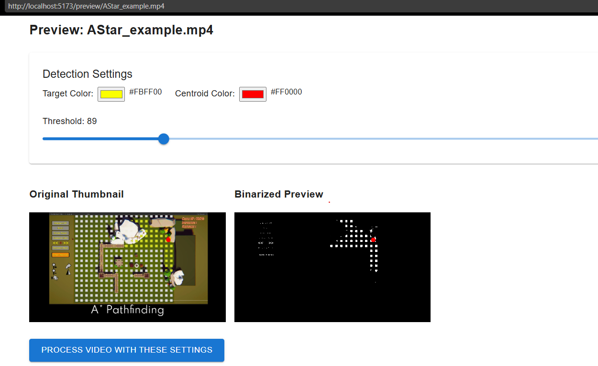

# Centroid Finder

Centroid Finder is a web application for analyzing videos. A user selects an available MP4 video, chooses a target color and distance threshold, and starts a processing job. The Java processor examines video frames, finds connected groups of pixels near the selected color, and writes each frame’s largest group centroid to a CSV file.

The project has three parts:

- **React frontend** — displays available videos, previews a selected video, and submits and tracks processing jobs.
- **Express server** — provides the API, generates video thumbnails with FFmpeg, and starts the Java processor.
- **Java processor** — uses JavaCV/FFmpeg to read video frames and produce CSV results.

## Requirements

Install the following tools before setup:

- Node.js and npm
- Java 25 or newer
- Maven
- FFmpeg is provided to the server through the `ffmpeg-static` dependency

The Java project’s Maven configuration targets Java 25. Make sure the Java version used to build and run the JAR is compatible.

## Repository layout

```text
frontend/    React application and frontend tests
server/      Express API, server tests, and generated outputs
processor/   Java video processor and Maven tests
videos/      User-provided MP4 videos (not included in Git)
```

## Preparing video files

Video files are not included in this repository.

Before running the application, create a `videos/` directory
at the repository root and add any `.mp4` files you want to process.

From the repository root:

```sh
mkdir -p videos
```
The resulting structure should look like:
```
SDEV334-centroid-finder/
├── frontend/
├── server/
├── processor/
└── videos/
    └── example.mp4
```
The Express server reads video files from this directory
using the VIDEO_DIR environment variable.

## Setup
**First, create a clone or fork of the repo**
```text
git clone https://github.com/KJeansGR/SDEV334-centroid-finder.git
cd SDEV334-centroid-finder
```

All setup instructions assume you start from the repository root.

The frontend and Express server must run in separate terminals
because both services need to remain active.

When opening a new terminal, navigate to the repository root
before following the instructions for that component.

### 1. Install frontend dependencies

**From the repository root:**

```sh
cd frontend
npm install
```

Create `frontend/.env`:

```dotenv
VITE_API_URL=http://localhost:3000
```

Start the frontend development server:

```sh
npm run dev
```

Vite normally serves the frontend at `http://localhost:5173`.

### 2. Build the Java processor

**From the repository root:**

```sh
cd processor
mvn clean package
```
if Windows cannot clean build files you may also be able to only run package and continue.
```sh
cd processor
mvn package 
```

Maven creates the executable JAR here:

```text
processor/target/my-java-project-1.0-SNAPSHOT-jar-with-dependencies.jar
```

### 3. Configure and start the Express server

**From the repository root:**

```sh
cd server
npm install
```

Create `server/.env` with paths appropriate to your setup:

```dotenv
PORT=3000
VIDEO_DIR=../videos
CSV_OUTPUT_DIR=./outputs
JAR_PATH=../processor/target/my-java-project-1.0-SNAPSHOT-jar-with-dependencies.jar
```

These paths are interpreted relative to the server process’s working directory. Start the server from `server/` so the example values resolve as shown.

Run the server:

```sh
npm run dev
```

The API should be available at `http://localhost:3000`. Start the frontend and server in separate terminals.

> The checked-in sample videos are in the repository-root `videos/` directory. If you configure `VIDEO_DIR=./videos` while running the server from `server/`, that instead points to `server/videos/`.

## Using the application

1. Open the frontend at `http://localhost:5173/videos`
   to view the available videos.
2. Select a video from the available-video list.
3. Choose a target color and threshold.
4. Start processing and wait for the job status to complete.
5. Follow the CSV download link shown when processing succeeds.

The frontend sends the selected video, target color, and threshold to the server. The server starts the Java JAR as a child process and returns a job ID. The frontend polls the server for that job’s status.

## API overview

### `GET /health`

Returns a basic response indicating that the Express server is running. This endpoint does not verify that the Java JAR, video directory, or output directory is usable.

### `GET /api/videos`

Returns the video names found in the configured video directory.

Successful response:

```json
{
  "success": true,
  "availableVideos": ["example.mp4"]
}
```

### `GET /thumbnail/:filename`

Generates and returns a JPEG thumbnail for a video. The current route accepts MP4 filenames and requires the video to exist in the configured video directory.

### `POST /process/:filename`

Starts processing a video. Pass the processing options as query parameters:

```text
/process/example.mp4?targetColor=FF0000&threshold=50
```

Optional parameter:

- `outputCsv` — CSV filename; defaults to `output.csv`.

The server validates the video name, CSV filename, target color (`RRGGBB`), and threshold (integer from 0 through 442). A successful request returns HTTP `202` with a job ID:

```json
{
  "success": true,
  "jobId": "job-identifier",
  "status": "processing"
}
```

Invalid parameters return HTTP `400`. The server may also return an error if it cannot access the video directory or start processing.

### `GET /process/:jobId/status`

Returns the current status for a job. A completed response includes an `outputCsv` name and a `csvUrl`; failed jobs include an error message. Unknown job IDs are not persisted and cannot be looked up after the server restarts.

### `GET /outputs/:filename`

Serves files from the configured CSV output directory. This includes generated CSV files and, currently, generated thumbnails.

<br />
<hr>
<br />

## Working front end screenshots example

| Available Videos | Video Preview | Processing Results |
|:---:|:---:|:---:|
|  |  |  |
| Video selection screen | Video preview and live binarizer | Processing status and results |


<br />
<hr>
<br />

## Running tests and checks

Run each command from its corresponding directory.

### Server tests

```sh
cd server
npm test
```

Uses Node’s built-in test runner.

### Frontend tests, lint, and production build

```sh
cd frontend
npm test
npm run lint
npm run build
```

Frontend tests use Mocha.

### Java tests and build

```sh
cd processor
mvn test
mvn clean package
```

The package command builds the executable JAR as well as compiling and testing the Java project.

## Java command-line usage

The processor can also be run directly:

```sh
java -jar target/my-java-project-1.0-SNAPSHOT-jar-with-dependencies.jar \
  <input-video> <output-csv> <hex-color> <threshold>
```

For example:

```sh
java -jar target/my-java-project-1.0-SNAPSHOT-jar-with-dependencies.jar \
  ../videos/FlowField_Example.mp4 ../server/outputs/result.csv FF0000 50
```

The color argument is a six-character hexadecimal RGB value (`RRGGBB`). The threshold is an integer from 0 through 442. Invalid arguments or processing errors cause the CLI to exit with a non-zero status.

## CSV output

The processor writes one row per analyzed video frame in the order `seconds,x,y`:

**Example csv output**
```text
0.0,-1,-1
0.033333,-1,-1
0.066666,-1,-1
```

The coordinates are the centroid of the largest detected connected group for that frame. If no matching group is found, the row uses `-1,-1` for the coordinates.

## Current limitations

- Job status is stored in memory by the server. Jobs are lost when the server restarts, and there is no configured job-retention policy.
- The server does not currently persist results or use a background queue.
- The frontend and server CORS configuration is set up for local development (`http://localhost:5173`); deployments may need different, deliberately configured origins.
- The `/outputs` directory is served statically. Keep only files intended to be publicly accessible there.
- The health endpoint checks that the server responds; it is not a full dependency or readiness check.
