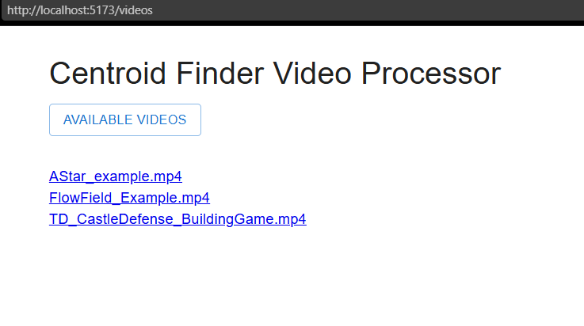

# Installation and usage

## **CLONE REPO**

```
git clone https://github.com/KJeansGR/SDEV334-centroid-finder.git
```

<br />
<hr>
<br />


## **FRONT END**

### 1. enter the frontend directory, and basic npm install:

```
cd SDEV334-centroid-finder/frontend<br /><br />
npm install<br /><br />
```

### 2. Create a .env file inside the frontend directory:

```
 VITE_API_URL=http://localhost:3000
```

### 3. Start the development server:

``` 
npm run dev 
```

<br />
<hr>
<br />

## Working front end screenshots example

| Available Videos | Video Preview | Processing Results |
|:---:|:---:|:---:|
|  |  |  |
| Video selection screen | Video preview and live binarizer | Processing status and results |


<br />
<hr>
<br />

## **BACK END (EXPRESS SERVER)**

### 1. Enter the server directory and install dependencies:

```
cd server
npm install
```

### 2. Create a .env file inside the server directory IMPORTANT!:

- These variables configure the server port, video directory, CSV output directory, and Java processor.
```
PORT=3000
VIDEO_DIR=./videos
CSV_OUTPUT_DIR=./outputs
JAR_PATH=../processor/target/my-java-project-1.0-SNAPSHOT-jar-with-dependencies.jar
```

### 3. Prepare the video and output directories:

- Still within the server directory 
```
 <br />mkdir -p videos outputs<br />
 Place any .mp4 videos you want to process inside server/videos/.<br /><br />
```
### 4. Start the Express server:

```
npm run dev
```


> The server should be available at:<br />
> http://localhost:3000<br /><br />
> You can verify the server is running at:<br />
> http://localhost:3000/health<br />

<br />
<hr>
<br />

## **JAVA PROCESSOR**

### 1. Build the Java processor using Maven:

- navigate to the processor folder first i use the example of "cdprocessor" here it may be different for you if you change the folder name!

```
cd processor
mvn clean package
```

> This compiles the Java project and creates an executable JAR with its dependencies. <br />
> The generated JAR will be located at: <em>processor/target/my-java-project-1.0-SNAPSHOT-jar-with-dependencies.jar</em> <br />
