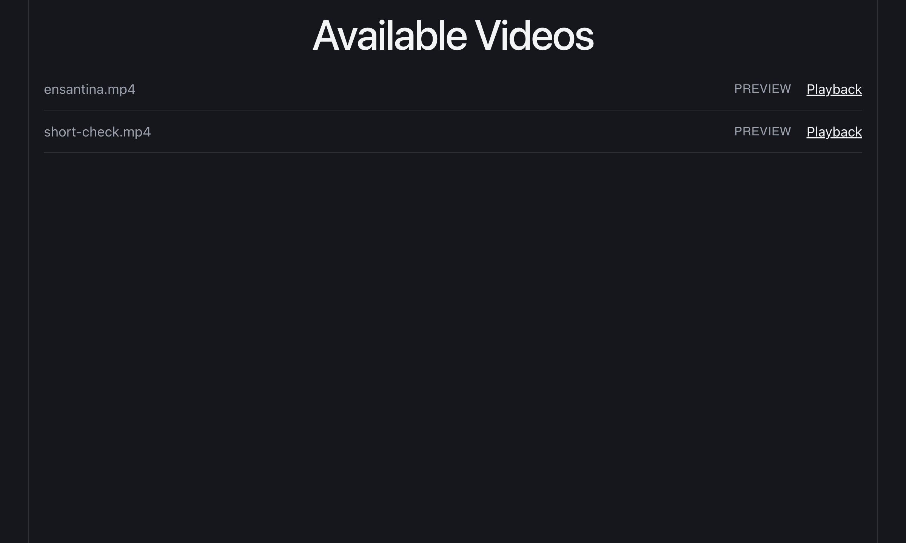
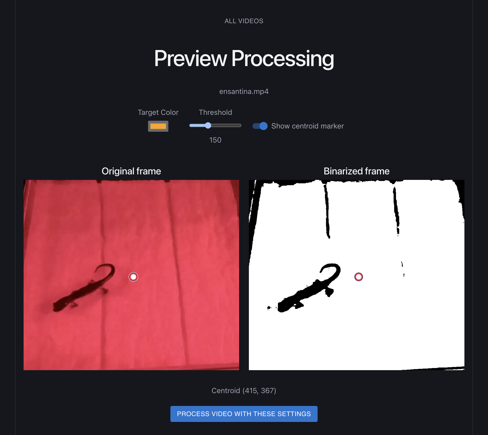

# Centroid Finder web app

Use **Preview** next to a video to open its first frame. Change the target color or threshold to refresh the original and binarized images. The marker uses the centroid of the largest matching group returned by Java. Use **Show centroid marker** to inspect either image without the overlay. **Process Video with These Settings** starts a separate full-video job. When it finishes, use **Download CSV**.





## Local setup

Use JDK 21 or newer, Maven, and Node.js 20.19 or newer. Run the following from the repository root.

1. Add an H.264-encoded MP4 or MOV to `processor/sampleInput/`. Create the directory if needed.
2. Build the Java processor and install the pinned npm dependencies.

   ```sh
   mvn -f processor/POM.xml package
   npm ci --prefix server
   npm ci --prefix frontend/centroidWeb
   ```

3. Start Express in one terminal.

   ```sh
   npm start --prefix server
   ```

4. Start Vite in another terminal and open [http://127.0.0.1:5173/videos](http://127.0.0.1:5173/videos).

   ```sh
   npm run dev --prefix frontend/centroidWeb -- --host 127.0.0.1
   ```

Express reads optional `PORT`, `VIDEOS_DIR`, `OUTPUT_DIR`, and `JAR_PATH` settings from the environment or the repository’s `.env`. Relative paths are resolved from the repository root. By default, the API uses port 3000 and writes outputs under `processor/sampleOutput/`. Set `CENTROID_API_URL` when launching Vite if Express uses a different address. Generated PNGs are stored in the `previews/` subdirectory and can be cleared between sessions. CSVs remain available in the output directory. Active and failed job status is held in memory.

## How it works

- React Router handles `/videos` and `/preview/:filename`. The preview uses the `withRequestStatus` higher-order component for loading and error states.
- The preview sends `videoFilename`, `hexColor`, and `tolerance` to `POST /api/preview` after 300 ms without a settings change. Java exports both images from the same decoded frame and returns their dimensions and the centroid. React positions each marker as a percentage of the image size.
- The process button sends the same settings to `POST /jobs`. React polls `GET /jobs/:jobId` every second until it receives a result. Express publishes the CSV after the Java process exits successfully.

## Verification

Run from the repository root. Keep Vite running on port 5173 for Cypress. The default Cypress suite mocks API responses.

```sh
mvn -f processor/POM.xml test
npm test --prefix server
npm run build --prefix frontend/centroidWeb
npm run lint --prefix frontend/centroidWeb
npm test --prefix frontend/centroidWeb
```

For the optional live browser tests, start both servers and add `ensantina.mp4` and a three-frame H.264 clip named `short-check.mp4` to the configured input directory. If FFmpeg is available, you can make the short clip with the following commands.

```sh
ffmpeg -i processor/sampleInput/ensantina.mp4 -frames:v 3 -an -c:v libx264 -pix_fmt yuv420p processor/sampleInput/short-check.mp4
npm test --prefix frontend/centroidWeb -- --config 'specPattern=cypress/live/*.cy.js'
```

The live tests verify the sample centroid and download a CSV from a real Java processing job. Cypress saves screenshots and downloads in ignored directories.
