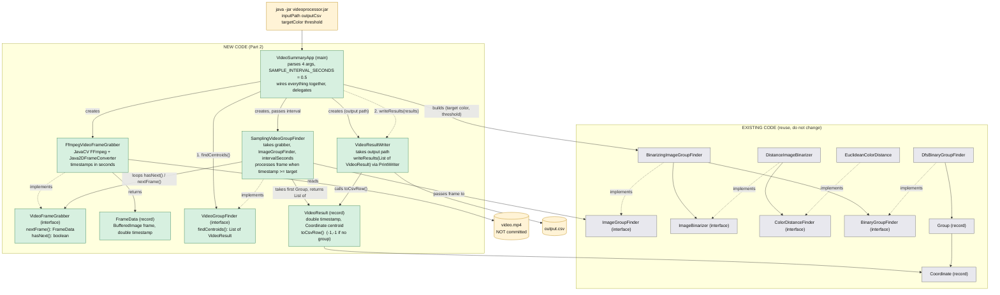

# Plan for switching from image inputs to videos while keeping our main original methods untouched.

Converted from Google Doc: https://docs.google.com/document/d/1t6ATUeCNYo4OVpAEKKKdjqTF32EmtA3LpzZjG0akklc/edit?usp=sharing

---

## Plan for OOP Architecture

- **VideoFrameGrabber (interface)**
  - Defines the contract as well as helper methods for grabbing frames from video.
  - Methods to be declared:
    - nextFrame(): returns a FrameData containing the current frame and timestamp, hasNext(): boolean that indicates whether another frame is available.

- **FfmegVideoFrameGrabber (class) (implements VideoFrameGrabber)**
  - Imports (JavaCV FFmpeg library)
  - Handles FFmpeg frame extraction
  - Converts each frame using Java2DFrameConverter, as well as providing a timestamp of each frame in seconds
  - Defines nextFrame() and hasNext() as specified in the interface.

- **FrameData (record)**
  - Holds a BufferedImage and a double timestamp in seconds
  - Is returned by nextFrame() so the finder knows when each frame happened

- **VideoGroupFinder (interface)**
  - Declares a findCentroids() method that, returns a List\<VideoResult\> representing the largest centroid found at each sampled frame.

- **SamplingVideoGroupFinder (class) (implements VideoGroupFinder)**
  - Takes in a VideoFrameGrabber and an ImageGroupFinder, and a double intervalSeconds in it's constructor.
  - Loops through all the frames using hasNext() and nextFrame(), processing a frame when current.timestamp() is >= target, (greater than or equal to because video frames do not always land on exact intervals.)
  - Passes current.frame() to ImageGroupFinder
  - Advances target by intervalSeconds after each processed frame.
  - Takes the first element from the returned List\<Group\>
  - Packages it as a VideoResult with the current.timestamp().
  - If the returned list is empty, packages a VideoResult with coordinate (-1, -1).

- **VideoResult (record)**
  - Holds: double timestamp and Coordinate centroid representing the location of the largest found group. Representing a single row meant to be added to the output CSV.
  - If no group is found in that frame the centroid will be (-1, -1).
  - Creates a toCsvRow() method to format the row data properly.

- **VideoResultWriter (class)**
  - Takes in an output file path in it's constructor.
  - Defines method writeResults(List\<VideoResult\>) that iterates through each VideoResult and calls toCsvRow() on each one.
  - Writes each formatted row to the CSV file using PrintWriter.

- **VideoSummaryApp (main class)**
  - Takes four command line arguments inputPath outputCsv targetColor threshold
  - Defines SAMPLE_INTERVAL_SECONDS = 0.5, as a constant and passes it to SamplingVideoGroupFinder().
  - Constructs a FfmpegVideoFrameGrabber, a BinarizingImageGroupFinder, and a SamplingVideoGroupFinder
  - Calls findCentroids() and passes the results to VideoResultWriter

---

## Dev Decisions

- **Sampling:** We decided on sampling one frame every half second. The interval will be a constant in VideoSummaryApp and is passed to SamplingVideoGroupFinder, so it is not a command line argument and the JAR will stay the same.
- **No Match:** If no group is found in a sampled frame, we return a result of a centroid not on the frame such as (-1,-1)
- **Errors:** Missing files, bad hex code, non-integer thresholds, or wrong number of arguments will print an error message and exit. VideoResultsWriter will report an output path it can't write to.
- **Reuse:** We are not changing any Part 1 classes except to fix previously unknown bugs
- **Largest group:** ImageGroupFinder returns groups sorted with the largest first so we take the first one from the list.

---

## Testing Plan

- **VideoResult:** toCsvRow() gives the proper format, including the (-1,-1)
- **SamplingVideoGroupFinder:** will use a fake VideoFrameGrabber and fake ImageGroupFinder, testing a normal frame, one with no groups, a null or empty video or gaps in the timestamps.
- **VideoSummaryApp:** we need to do argument checks such as wrong count, bad hex, bad threshold.
- **FfmpegVideoFrameGrabber:** one test on a sample video to check frames and timestamps come out as expected

---

## Packaging

- Maven with VideoSummaryApp as the main class, and the JAR won't be committed

---

## Architectural Diagram

**Legend:** green = new code for Part 2, grey = existing Part 1 classes we reuse unchanged, orange = inputs and outputs. Solid arrows mean "uses" or "creates", and dotted arrows mean "implements".