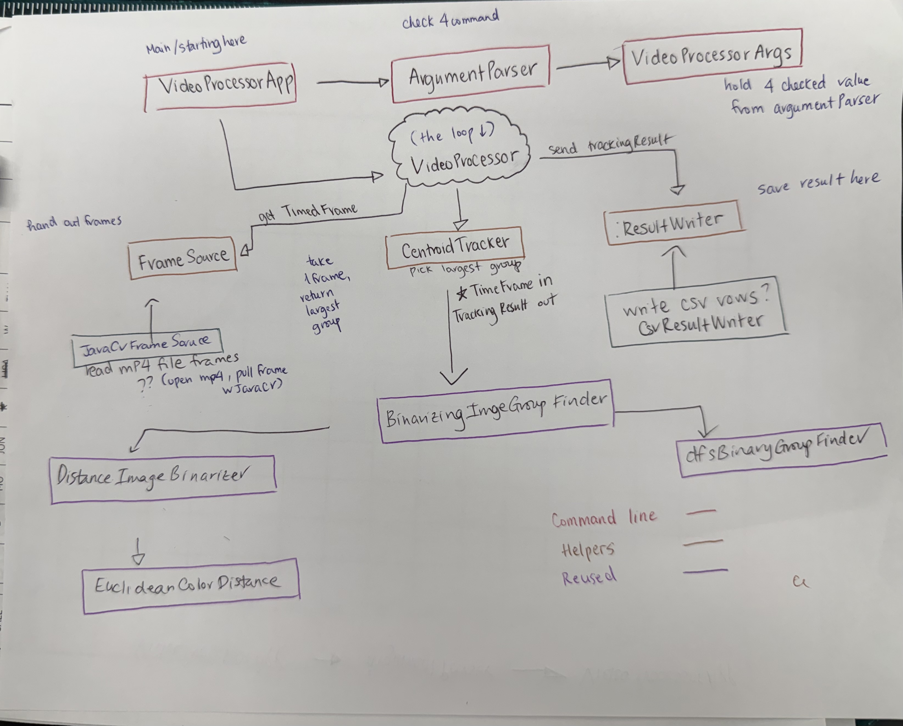

## Goal

Build a command line tool that reads an MP4, runs every frame through 
centroid-finder logic, and writes a CSV tracking the largest group's centroid over time.

## Architechture


```
 java -jar videoprocessor.jar inputPath outputCsv targetColor threshold
 ```

Example output (`seconds,x,y`):

AI Example:
``` 
0.000,412,233
0.033,413,233
0.067,-1,-1
```

If no group matches in a frame, we write `-1,-1` for the coordinates.

---

## Library choice

We are going with **JavaCV** (`FFmpegFrameGrabber` + `Java2DFrameConverter`).
 It hands us frames we can convert straight into `BufferedImage`, which is the
exact input type our `ImageGroupFinder` already accepts. 
---

 AI used to make pretty
## What we RE-USE 
| Existing class | Role in the video tool |
|---|---|
| `ColorDistanceFinder` / `EuclideanColorDistance` | Color distance from each pixel to the target color |
| `ImageBinarizer` / `DistanceImageBinarizer` | Turns each frame into a 0/1 array |
| `BinaryGroupFinder` / `DfsBinaryGroupFinder` | Finds connected groups and their centroids |
| `ImageGroupFinder` / `BinarizingImageGroupFinder` | One call: frame in → sorted groups out |
| `Group`, `Coordinate` | Data passed between components |


The video tool never touches pixels directly. It just feeds `BufferedImage`s into an
`ImageGroupFinder`. That means all the hard image logic is already tested.

`ImageSummaryApp`  it is useful for checking a single frame during validation
`VideoExperiment` was our experiment and will be replaced by the classes below.

---

AI Used to help create a nice table, asking AI how to make a table and what are some things i need to include
## New components

| New class | Responsibility |
|---|---|
| `VideoProcessorApp` | `main`. Parses args, wires objects together, prints errors. No logic of its own. |
| `ArgumentParser` | Turns `String[] args` into a `VideoProcessorArgs`; throws `IllegalArgumentException` with a clear message on bad input. |
| `VideoProcessorArgs` (record) | `inputPath`, `outputCsv`, `targetColor` (int `0xRRGGBB`), `threshold` (int). |
| `FrameSource` (interface, `Closeable`) | `Optional<TimedFrame> nextFrame()` — hands out frames one at a time. |
| `JavaCvFrameSource` | The only class that knows about JavaCV. Wraps `FFmpegFrameGrabber` and `Java2DFrameConverter`. |
| `TimedFrame` (record) | `double seconds`, `BufferedImage image`. |
| `CentroidTracker` | Given a `TimedFrame`, asks the `ImageGroupFinder` for groups and returns a `TrackingResult` with the largest group's centroid, or `(-1,-1)`. |
| `TrackingResult` (record) | `double seconds`, `Coordinate centroid`; has `toCsvRow()`. |
| `ResultWriter` (interface, `Closeable`) | `void write(TrackingResult r)`. |
| `CsvResultWriter` | Writes `seconds,x,y` lines to a `Writer` (a file in real use, a `StringWriter` in tests). |
| `VideoProcessor` | The loop: pull frame → track → write, until the source is empty. Depends only on interfaces. |

- Changed FrameSource and ResultWriter to Closeable instead of AutoCloseable

## Validation plan 

**Choosing color and threshold**
1. Export one frame of the salamander video to PNG 
2. Use an eyedropper tool to sample the salamander's color in a few spots; pick a middle value.
3. Run `ImageSummaryApp` on that frame with a few thresholds and look at `binarized.png`.
   Good settings show the salamander as one solid white blob with little background noise.
4. Repeat on a frame from early, middle and late in the video, since lighting can change.

**Checking it actually tracks the salamander**
- Spot-check: pick 3 timestamps, pause the video there, and compare the salamander's position with
  the CSV's `x,y`.
- Plot `x` and `y` over time; the path should be smooth. Big sudden jumps likely mean the largest
  group switched to something else.
- Count the `-1,-1` rows; lots of them means the threshold is too tight.


TODO
**Results** 
- Color chosen:
- Threshold chosen:
- What we observed / what we changed:
