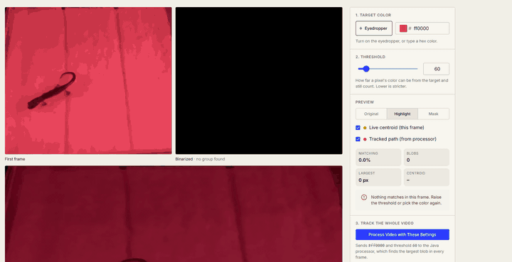

# centroid-finder

Centroid Finder tracks colored objects in video. You give it a video, a target
color and a threshold. It binarizes each frame (pixels close to the target color
become 1, everything else 0), finds the connected groups of 1s, and reports the
centroid of the largest group per frame. 



*The web app (front end + this server) at 2× speed.*

The project has three parts:

| Processor | [`processor/`](processor/) | Java app that does the image and video analysis and packages into one runnable JAR. |

| Server | [`server/`](server/) | Node.js (Express) API that stores uploaded videos, runs the JAR as a job, and serves results. |

| Front end | `centroid-finder-frontend` ([separate repo](https://github.com/buaypd/centroid-finder-frontend)) | React app for uploading videos, previewing the mask and starting jobs. |

## How it works

**Processor (Java).** The processor tracks the centroid of an object in a video.
For each frame it finds the group of pixels that matches the target color and
takes the centroid of the largest group. Running it over the whole video gives a
CSV file with one row per frame


**Server (Node).** The server is an API built in Node with Express. It has 7
endpoints:

- `GET /api/videos` lists the videos
- `POST /api/videos` uploads a video
- `GET /thumbnail/:filename` returns a thumbnail of a video
- `POST /process/:filename` starts processing a video
- `GET /process/:jobId/status` returns the status of a job while it runs
- `/videos/...` serves the video files
- `/results/...` serves the result CSVs

Each processing run is stored as a job in SQLite (`better-sqlite3`). A job keeps
its `id`, `filename`, `targetColor`, `threshold`, `status`, `result`, `error`
and `createdAt`, so the front end can check on it until it finishes.


**Front end (React).** The front end lets you upload video files, pick a video
and preview it. It has an eyedropper with a crosshair for picking the target
color straight from the video, and a live preview of the binarized mask so you
can tune the threshold before sending the job to the server.

The web app needs the server and the front end running together.

## Build the JAR

From the repo root:

```
cd processor
mvn package
```

## How to start the server

```
cd server
npm install
npm start
```

The server then runs on `http://localhost:3000`
`npm run dev` 

Endpoints:

- `GET /api/videos` lists uploaded videos
- `POST /api/videos` uploads a video
- `GET /thumbnail/:filename` returns a video's thumbnail
- `POST /process/:filename` starts a processing job
- `GET /process/:jobId/status` checks a job's status

## How to start the front end

The front end lives in its own repo:
[centroid-finder-frontend](https://github.com/buaypd/centroid-finder-frontend).


```
git clone https://github.com/buaypd/centroid-finder-frontend.git
cd centroid-finder-frontend
npm install
npm run dev
```

Then open <http://localhost:5173>.

# Project Shine Ideas
- Clearer and user friendly error messages
- Process more than one video at a time