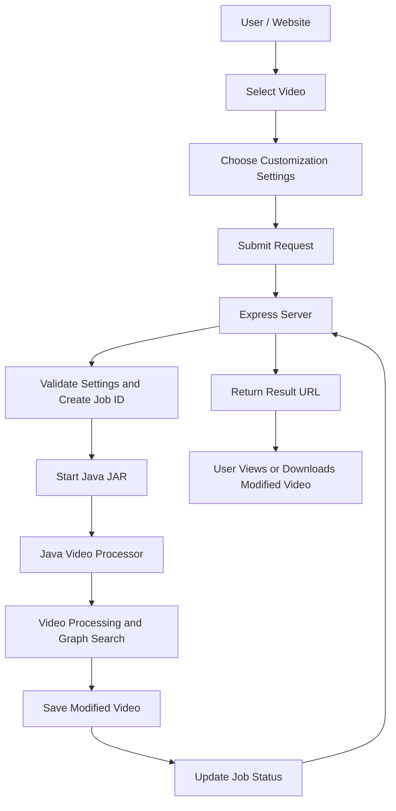
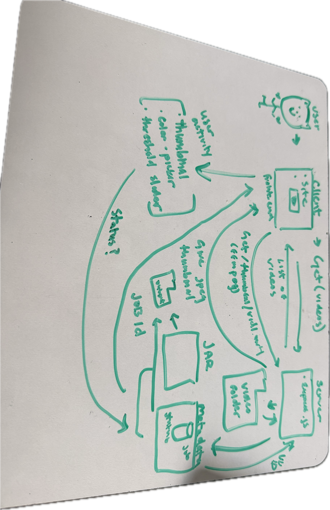

# Salamander API – Updated Server Plan

## 1. Overview

unsure if we're going to be implementing both video and images or just work with images 
- backend- 
I plan to create a website that allows users to select a video and customize how they want that video processed.
Users will be able to choose a video and change different settings, such as color, opacity, and grouping. After selecting their desired settings, they will submit their request and receive a modified video when processing is complete.

I plan to use Node.js and Express to build the server. Express will handle communication between the website and my existing Java videoProcessor JAR.

The Express server will not contain any graph-search or video-processing algorithms. Instead, it will pass the user's selected video and customization settings to the Java JAR. The Java program will handle all the actual processing.

For now, videos will be stored locally in a directory on my computer. Users will select from the available videos rather than uploading their own.


- frontend- 
Kate and I decided to go with a star theme design with pastel colors such as purple, cyan, and yellow. The background will be a purple sky with animated clouds that are drop down and user-designated, meaning a drop down menu will appear if users click on the cloud icon. There would be an estimate of 6 pages: HomePage, Video Processor, Video Editor, Image Processor, Image Editor, ResultPage. 

## 2. Architecture

AI Used to help create template

Pictures: 



The main responsibilities are:

- **Frontend:** Allows users to select videos and customize processing settings.
- **Express:** Receives requests, validates settings, starts the Java JAR, and tracks job progress.
- **Java JAR:** Performs video processing and all graph-search operations.
- **Filesystem:** Stores original videos, processed videos, thumbnails, and job status information.

## 3. Video Customization Options

The website will allow users to customize how their selected video is processed.

Some possible settings include:

- **Color:** Choose a target color or color to search for.
- **Opacity:** Choose how transparent or visible certain elements should be.
- **Grouping:** Choose how detected objects or pixels should be grouped.

The frontend will send these settings to Express along with the selected video filename.

Express will validate the settings and pass them to the Java JAR as command-line arguments.

The Java program will be responsible for understanding and applying these settings.

The exact customization options will depend on which features the Java JAR supports.

## 4. API Endpoints

### GET /api/videos

Returns video that the user customized.

Express will:
- Read the local videos directory using Node.js filesystem methods.
- Find available video files.
- Return the filenames as JSON.

### GET /thumbnail/:filename

Returns a thumbnail of the selected video. >> Can be logo of website 

Express will:
- Locate the requested video.
- Use FFmpeg to extract the first frame.
- Return the thumbnail as a JPEG image.

### POST /process/:filename

Starts processing a selected video using the user's customization settings.


** POSSIBLE CHANGE IN PROGRESS **
The request will include settings such as: 

- Target color.
- Color threshold.
- Opacity.
- Grouping options.

Express will:
1. Validate the selected video and customization settings.
2. Generate a unique job ID using UUID.
3. Create a job status record.
4. Start the Java videoProcessor JAR using Node.js child_process.
5. Pass the selected video path and customization settings to Java.
6. Allow the Java process to run independently in the background.
7. Immediately return the job ID to the frontend.

The Java JAR will perform all video processing and graph searching.

### GET /process/:jobId/status

Allows the website to check whether the video is still processing.

Express will:
- Find the job using its job ID.
- Read the current processing status.
- Return whether the job is processing, completed, or has failed.
- If completed, return a URL to the modified video.

Once processing is finished, the website will use the returned URL to display or download the modified video.

## 5. Java JAR Communication

The Express server will use Node.js  to start the Java videoProcessor JAR.

The server will pass the selected video and the user's customization settings to the JAR.

The Java program will handle the actual video processing, including  graph-search logic.

The Java program will save the modified video and update its job status so Express can retrieve the results.

## 6. File Storage

I plan to store files locally using the filesystem.

```text
UserInput/
├── videos/
│   ├── video.mp4
│   └── image.png
│
├── UserOutput/
│   ├── modified-video-1.mp4
│   └── modified-image-2.png
│
├── thumbnails/
│
├── jobs/
│   ├── job-id-1.json
│   └── job-id-2.json
│
├── videoProcessor.jar
├── server.js
├── serverPlan.md
└── .env
```

The jobs directory will store information about each processing request, including its ID, selected video, customization settings, status, and result location.

## 7. Environment Variables

Using dotenv to store important directory paths and configuration values in a `.env` file.

ex port from prev classes
```env
PORT=3000
VIDEOS_DIR=./videos
RESULTS_DIR=./results
THUMBNAILS_DIR=./thumbnails
JOBS_DIR=./jobs
JAR_PATH=./videoProcessor.jar
```

This will make it easier to change file locations without modifying the Express code.

## 8. Implementation Order

1. Set up the Express server.
2. Install Express, dotenv, and UUID.
3. Configure the environment variables.
4. Implement the page where users can upload video/image.
5. Implement thumbnail generation using FFmpeg.
6. Create the frontend request structure for video customization settings.
7. Implement job ID generation and job status storage.
8. Implement communication between Express and the Java JAR.
9. Pass the selected video and customization settings to Java.
10. Implement job status checking.
11. Return the modified video/image to the frontend.
12. Test the entire process from selecting a video to receiving the finished video.

## 9. Things to Research

- Express routes and HTTP requests.
- dotenv and environment variables.
- Node.js and running Java JAR files.
- Detached processes.
- UUID for generating job IDs.
- FFmpeg for extracting video thumbnails.
- Passing customization settings from Express to Java.


