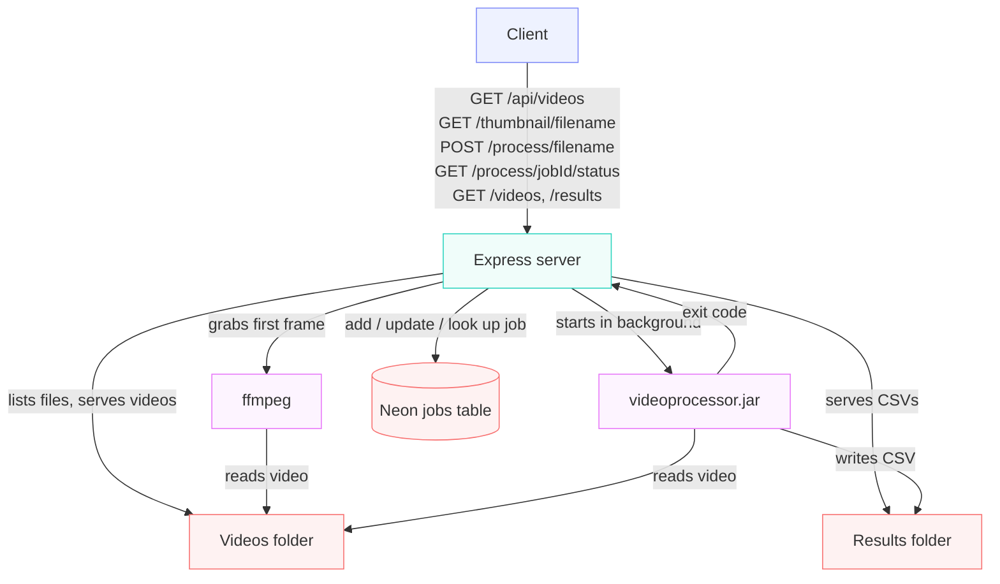

# Server Plan

API spec: https://github.com/auberonedu/salamander-api

## Notes on the API
<!-- For each endpoint: what does the client send? what does the server send back (success + errors)? does it need the JAR, ffmpeg, or just files/folders? -->

### GET /api/videos
What URL and method is it? 
- Get only reads the information and doesnt change the server.
What does the client send?
- Nothing, no file name . no query. Client only asking what videos do we have 
What does the server send back when it works, and when it fails?
- When it works it should send 200 ok with a json array of file names
- when it fails gives us a 500 error code 
- {"error": "Error reading video directory"}
Does it need the JAR, ffmpeg, or just files and folders?
- Just a folder, the server reads the list of files in the videos folder
- (nodes) its a specific function that node uses fs.readdir
- it doesnt need a jar or ffmpeg, simplised end point to test 

### GET /thumbnail/{filename}
What URL and method is it?
- It's a GET because it only reads. It doesn't do anything except get the first frame of the video and show it.
- From the client's point of view, no job starts and no file gets added (even if our server makes a temporary JPG).
- Because it's a GET, you can paste the URL right into a browser and see the image, which is exactly what a thumbnail should do.
- {filename} is a path parameter. The curly braces mean "a value goes here". It's part of the URL path itself, so:
  - GET /thumbnail/intro.mp4 → filename is intro.mp4
  - GET /thumbnail/demo.mov → filename is demo.mov
- In Express you write the route as /thumbnail/:filename, with a colon instead of curly braces, and read it with req.params.filename.
What does the client send?
- The video name in the URL path, asking the server to show us the first frame of that video.
- How it differs from /api/videos: that one has no path parameter, because it's about all the videos. This one has to say which video.
What does the server send back when it works, and when it fails?
- When it works it sends 200 OK with the JPEG image itself (not JSON), with the header Content-Type: image/jpeg
- When it fails it sends a 500 error code
- {"error": "Error generating thumbnail"}
Does it need the JAR, ffmpeg, or just files and folders?
- We chose ffmpeg. It needs something that can open a video and grab the first frame, so the server runs one ffmpeg command instead of starting our JAR.

### POST /process/{filename}?targetColor=...&threshold=...
What URL and method is it?
- It's a POST because it updates the server: it creates a new job (new jobId), starts the JAR, and makes a new CSV
- You can't start it by pasting the URL in a browser, because that always sends a GET

What does the client send?
- The video filename in the URL path (req.params.filename)
- targetColor and threshold in the query string after the ? (req.query.targetColor, req.query.threshold)
- The client picks the color and threshold. ff0000 and 120 on the API page are just examples

What does the server send back when it works, and when it fails?
- 202 Accepted with {"jobId": "..."}: it means "got it, working on it", not "done"
- It sends the 202 right away, because the JAR takes about a minute and the request can't wait
- The client uses the jobId to check on it with GET /process/{jobId}/status
- 400 if targetColor or threshold is missing (the client's fault)
- 500 if the server can't start the job, like a wrong JAR path (the server's fault)

Does it need the JAR, ffmpeg, or just files and folders?
- It needs the JAR, started in the background (detached, ignore stdio, unref)
- inputPath = videos folder from .env + the filename from the URL
- outputCsv = results folder from .env + the jobId, like 123e4567-....csv (see Results folder and CSV name)
- targetColor and threshold come from the query string
- It also needs the JAR's path from .env

### GET /process/{jobId}/status
What URL and method is it?
- It's a GET, reads the information and doesn't change anything on the server

What does the client send?
- only job ID, in the URL path, it's the jobId the server returned from POST /process. there's no request body and no query string

What does the server send back when it works, and when it fails?
- 200 with "processing" the JAR is still running
- 200 with "done" and a "result" path to the CSV
- 200 with "error" and an error message
- a failed job is still a 200 because the status request itself worked
- 404: the server has never heard of that job ID.
- 500: the server itself broke while trying to look up the job, for example it couldn't read its job storage.

Does it need the JAR, ffmpeg, or just files and folders?
- neither. The JAR was already started by POST /process.
- the server just looks up the job's saved status, which updates when the JAR exits (0 = done, anything else = error)

### Videos at /videos/VIDEO_NAME
What URL and method is it?
- It's a GET, like /videos/intro.mp4. It just gives back the video file, so the client can play it.
- It's not one of the 4 endpoints. The spec just says every video from /api/videos can be found here.

What does the client send?
- only the video name in the URL path

What does the server send back when it works, and when it fails?
- the video file itself (not JSON)
- if the file isn't there, a 404

Does it need the JAR, ffmpeg, or just files and folders?
- just the videos folder. We don't write a route for it, express.static shares the whole folder in one line.

## Extra endpoints for the frontend's UI upgrade
These aren't in the API spec. We added new endpoints instead of changing the spec's ones, so GET /api/videos still sends a plain list of names.

| Method and URL | What the client sends | What it sends back | Errors |
|---|---|---|---|
| GET /api/videos/details | nothing | 200 `[{ filename, status, durationSeconds?, width?, height? }]` | 500 |
| GET /api/jobs | nothing | 200 every job, newest first: `[{ jobId, filename, targetColor, threshold, status, startedAt, resultUrl?, error? }]` | 500 |
| GET /api/jobs/{jobId} | jobId in the path | 200 one job (same shape) | 404, 500 |
| GET /frame/{filename}?t=2.5 | file name in the path, seconds in t | 200 a PNG of the frame at that time | 400 bad t, 404 t is after the end, 500 |
| POST /api/videos | multipart form, the file in the field `video` | 201 `{ filename, status: "not-processed", ... }` | 400, 409 name taken, 413 over 2 GB, 415 not .mp4/.mov |
| GET /api/health | nothing | 200 `{ ok: true, version }` | none |

How they work:
- videos/details: reads the videos folder like /api/videos, then uses the newest job for each file: done → tracked, processing → processing, error → error, no job → not-processed. ffprobe (with execFile, no shell) adds the length and size; if ffprobe can't read a file, those fields are left out.
- jobs: the job store has a new listJobs() (`ORDER BY created_at DESC` in Neon). startedAt is the created_at column. There's no finished time yet, because the table has no column for it.
- frame: like /thumbnail, but `-ss <t>` jumps to that time first, and it's a PNG so the colors are exact. path.basename keeps it inside the videos folder.
- upload: multer writes the file to disk while it arrives (it never has to fit in memory). It checks the name, the type, and that the name isn't taken before saving anything. The file is saved as `name.<uuid>.part` first and only gets its real name when the whole file has arrived, so half-uploaded videos never show up in /api/videos.
- health: a quick "is the server up?" check. The version comes from server/package.json.

Tests: jobsRoute, videoDetailsRoute, frameRoute, uploadRoute, healthRoute, and neonJobStore (with a fake pg Pool) `.test.ts` files, run with npm test.

## Questions
<!-- Things we don't understand yet, or want to ask the professor -->
- The jobs are shared in Neon, but each CSV is saved on the laptop that ran the JAR. If my partner looks up my job, it says done, but their server doesn't have the file. Is that OK?
- What should happen if someone asks for a video that doesn't exist? The spec only lists 500 for /thumbnail and 400/500 for /process.
- What should happen if the server stops while a JAR is running (like Ctrl+C)? The exit listener only lives in the server's memory, so after a restart nothing updates the job and it will still be marked as processing forever. Our idea: on startup, mark any jobs still processing as error ("server restarted"). The catch is that the JAR is detached, so it might still finish, and the job would say error even though the CSV is done.

## Decisions
<!-- What we chose and WHY -->

### Express + TypeScript
Why Express

- It's the default option in the assignment.
- We've already learned it in other classes, so the team doesn't have to learn a new framework.
- It has simple tools for everything the API needs: routes like /thumbnail/:filename, express.static for the videos and results folders, and JSON responses.

Why TypeScript

- We all wanted to learn TypeScript, and this project is a good chance to practice it.
- It catches mistakes before the code runs. For example, the job status can only be "processing", "done", or "error". TypeScript warns you if someone types "finished" by mistake.
- It's clearer. The types show what each function takes and returns.
- It's still JavaScript underneath, so all the same Node and Express code works.

The Downside 
- TypeScript is new for all of us and will be an extra setup

### Tracking jobs: database or files?
We chose a database: Neon (PostgreSQL in the cloud).

Scalability: if we had lots of jobs or users, a database can search and update them safely. Files would get messy.

Jobs survive a restart: if the server restarts, the jobs are still saved, so /status still works. A Map in memory would forget them.

We all share one database: Neon runs in the cloud, so the 3 of us connect to the same database and nobody has to install anything.

Downsides: it needs internet, the connection string is a password so it must stay out of git, and it's more to learn than a Map or files.

### Thumbnail: ffmpeg or our JAR?
We chose ffmpeg.

Speed: the frontend will probably show a thumbnail for every video. Starting our big JAR each time would take a second or more per video, and ffmpeg is almost instant.

The JAR keeps one job: our JAR already does one thing (video in → CSV out). Adding a thumbnail mode would mean changing how it reads its arguments and writing more tests, just to grab one frame.

Easy to install: we all have Macs with Homebrew, so it's just brew install ffmpeg. We'll add that to the README.

Downside: if someone hasn't installed ffmpeg, thumbnails won't work, so the server should send a clear 500 error when that happens.

## Plan
<!-- How each endpoint will work, step by step. What goes in .env? Where do results go? Who is doing what? -->

### Database (Neon)
Setting it up (one person does this):
1. Make a Neon project at neon.tech
2. Copy the connection string (keep the ?sslmode=require at the end)
3. Make the jobs table in Neon's SQL Editor, and save the same CREATE TABLE in server/schema.sql
4. Send the connection string to the team privately, never on GitHub

The jobs table (one row per job):
- id: the jobId from uuid
- filename: the video, like intro.mp4
- targetColor and threshold: what the client sent
- status: processing, done, or error
- result: the path to the CSV (empty until done)
- error: the error message (empty unless it failed)

How the endpoints use it:
- POST /process: add a row with status processing, start the JAR, send back the id
- when the JAR exits: update the row to done (exit code 0) or error (anything else)
- GET /process/{jobId}/status: look up the row by id, 404 if there's no row

In the server: the pg package talks to Neon (npm install pg, npm install -D @types/pg)

Before anyone puts the connection string in .env (done):
- add .env to .gitignore ✅
- git rm --cached .env (because .env was already committed) ✅
- commit a .env.example with the names but no real values, like DATABASE_URL= ✅

### Results folder and CSV name
- Each CSV is named after the jobId, like results/123e4567-....csv
- Why jobId and not the video name (the API example uses intro.mp4.csv): with the video name, two jobs on the same video with different colors would overwrite each other's CSV
- The CSV name matches the job's id in the jobs table, so it's easy to find a job's result
- The results folder is shared with express.static at /results (like the videos), so the result column holds a URL like /results/123e4567-....csv instead of a path on our laptop

### What goes in .env
- DATABASE_URL: the Neon connection string
- PORT: the port the server runs on, like 3000
- VIDEOS_DIR: the folder with the videos, like /Users/you/centroid-finder/processor/sampleInput
- RESULTS_DIR: the folder the CSVs get written to
- JAR_PATH: where videoprocessor.jar is, like /Users/you/centroid-finder/processor/target/videoprocessor.jar
- Use full paths: a short path like processor/sampleInput would be looked up from the folder the server starts in (server/), so it would point to the wrong place
- Each of us has different paths on our laptops, so everyone has their own .env (only .env.example goes on GitHub)

### Each endpoint, step by step
GET /api/videos
1. Read the file names in VIDEOS_DIR with fs.readdir
2. Send back 200 with the names as a JSON array
3. If the folder can't be read, send 500 {"error": "Error reading video directory"}

GET /thumbnail/{filename}
1. Build the video's path: VIDEOS_DIR + req.params.filename
2. Run ffmpeg to grab the first frame as a JPEG, and have it send the image straight back to the server (no file saved)
3. Send back 200 with the image and Content-Type: image/jpeg
4. If ffmpeg fails (no video, or ffmpeg not installed), send 500 {"error": "Error generating thumbnail"}

POST /process/{filename}?targetColor=...&threshold=...
1. Check that targetColor and threshold are there. If not, send 400 and stop (nothing gets started)
2. Make a jobId with uuid
3. Add a row to the jobs table with status processing
4. Start the JAR in the background: java -jar JAR_PATH inputPath outputCsv targetColor threshold
   - inputPath = VIDEOS_DIR + filename, outputCsv = RESULTS_DIR + jobId.csv
   - detached, stdio ignored, and unref, so the server doesn't wait for it
5. Listen for the JAR's exit event. When it exits, update the row: done with the result URL (exit code 0), or error with a message (anything else)
6. Send back 202 {"jobId": ...} right away, without waiting for step 5
7. If adding the row or starting the JAR fails, send 500 {"error": "Error starting job"}
- Step 5 can still happen after the 202 is sent, because the server keeps running and Node tells it when the JAR exits

GET /process/{jobId}/status
1. Look up the row by id in the jobs table
2. No row: 404 {"error": "Job ID not found"}
3. Send 200 with the status. Add result if it's done, or error if it failed
4. If the database can't be reached, send 500 {"error": "Error fetching job status"}

/videos/VIDEO_NAME and /results
- express.static shares VIDEOS_DIR at /videos and RESULTS_DIR at /results. No routes to write

### Who does what
Each of us owns the endpoints we wrote notes for, and writes the unit tests and Postman checks for them.

Jessica: server setup + the simple endpoints
- Express + TypeScript starting point (index.ts, dotenv loading .env, npm scripts)
- express.static for /videos and /results
- GET /api/videos
- GET /thumbnail/{filename} (ffmpeg)

Nadia: database + status
- Neon project, the jobs table, and server/schema.sql
- The code that adds, updates, and looks up job rows (using pg)
- GET /process/{jobId}/status

Paris: processing jobs
- POST /process/{filename} (checking the query params, making the jobId)
- Starting the JAR in the background (detached, stdio ignored, unref)
- Listening for the JAR's exit and marking the job done or error (using Nadia's database code)

Order:
1. Jessica's server setup goes first, since everyone's routes plug into it
2. Nadia's database code goes before Paris's exit handling, since it updates the job rows
3. Paris can start on the JAR part at the same time, since it doesn't need the database yet

## Architecture diagram
<!-- Client → Express → JAR / ffmpeg / folders -->

## Testing plan
<!-- Unit tests + Postman checks -->

### Tools: Vitest + supertest
- Vitest runs our tests. It works with TypeScript without extra setup, so it can run our .ts files directly.
- supertest sends fake requests to our Express app, so we can test each endpoint without starting the real server.
- They're like JUnit for our Java code: npm test in server/ works like mvn test in processor/.

### Installing
- One person installs them once, in server/:
  npm install -D vitest supertest @types/supertest
- -D means they're only for development (testing), not for running the server.
- That person changes the "test" script in package.json to "vitest", then commits package.json and package-lock.json.

### Does everyone need to install them?
- Not separately. Vitest and supertest get saved in package.json.
- Everyone else just pulls and runs npm install in server/ (we already have to do this after pulling). That installs them automatically, the same version for everyone.
- node_modules/ isn't committed (it's in .gitignore), so each person's npm install makes their own copy.

### Unit tests (automatic)
- We test each endpoint without the real JAR or the real Neon database, using fakes like the fake FrameReader in our Java tests:
  - a fake job store that uses a Map instead of Neon (so our test jobs don't end up in the shared database)
  - a fake JAR runner that just remembers what it was asked to run
- GET /api/videos: a test folder → 200 with the names; a missing folder → 500
- POST /process: color and threshold given → 202 with a jobId; one missing → 400; the job store fails → 500
- GET /process/:jobId/status: processing / done / error → 200 with the right JSON; unknown jobId → 404
- When the JAR exits: code 0 → done, anything else → error
- Test files end in .test.ts, and we run them with npm test in server/

### Postman checks (by hand, real server)
1. GET /api/videos lists our videos
2. GET /thumbnail/bright_balloon_sample_video.mp4 shows the first frame
3. POST /process/bright_balloon_sample_video.mp4?targetColor=FF4500&threshold=100 sends back 202 right away, not after the video is done
4. GET /process/{jobId}/status says processing, then done
5. The result CSV matches what the JAR makes when we run it by hand
6. Error cases: missing color or threshold → 400, made-up jobId → 404, bad color like ZZZZZZ → the job ends as error

### Who
- Whoever builds an endpoint writes its tests
- mvn test in processor/ should still pass

### Results (what we checked so far)
Unit tests: 26 passing with npm test in server/ (jarRunner, startJob, job store, POST /process, status route).

Real server, real JAR, real Neon (sent with curl and the browser instead of Postman):

| Check | Request | What we got |
|---|---|---|
| 1 | GET /api/videos | ["bright_balloon_sample_video.mp4","ensantina.mp4"] |
| 2 | GET /thumbnail/ensantina.mp4 | 200, image/jpeg, the salamander's first frame |
| 3 | POST /process/bright_balloon_sample_video.mp4?targetColor=FF4500&threshold=100 | 202 with a jobId right away |
| 3 | POST /process/ensantina.mp4?targetColor=650010&threshold=40 | 202 with a jobId right away, even though the JAR took a few minutes |
| 4 | GET /process/{jobId}/status for the salamander job | {"status":"done","result":"/results/<jobId>.csv"} |
| 5 | GET /results/<jobId>.csv | the CSV, served by express.static |
| 6 | POST /process/ensantina.mp4?threshold=40 | 400 Missing targetColor or threshold query parameter. |
| 6 | GET /process/not-a-real-id/status | 404 Job ID not found |
| 6 | GET /thumbnail/nope.mp4 | 500 Error generating thumbnail |
| 4 | GET /process/{jobId}/status right after starting a salamander job | {"status":"processing"}, then done a few minutes later |
| 6 | POST /process/ensantina.mp4?targetColor=ZZZZZZ&threshold=40, then GET its status | 202 first, then {"status":"error","error":"Error processing video: the JAR exited with code 1"} (our Java ArgumentParser rejects the color) |

The result CSVs match what the JAR makes when we run it by hand:
- Balloon: 275 rows, from 0.000,1080,581 to 10.960,1107,597
- Salamander: 11,477 rows (every frame), 0 missing, 0 on the top edge, 0 big jumps, and (39, 581) at 83 seconds, the same as our Wave 4 validation in plan.md

Jobs survive a restart: the salamander job ran before the status route existed, and the server restarted several times after, but GET /status still said done because the job is saved in Neon.

Safety: POST /process and GET /thumbnail use path.basename on the filename, so a name like ../../secret.mp4 only looks for secret.mp4 inside the videos folder.

Not checked yet:
- Unit tests for GET /api/videos and GET /thumbnail

