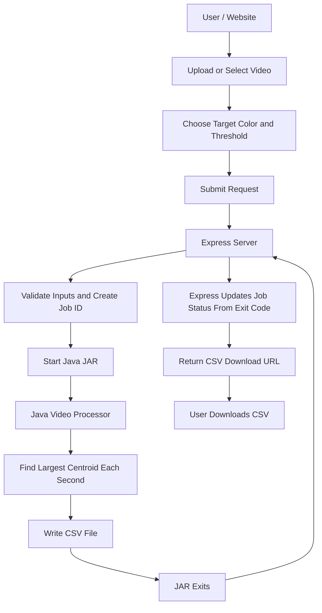

# Salamander API – Updated Server Plan

## 1. Overview

This project is video only (no image processing).

- backend-
I plan to create a website that allows users to upload a video or pick one that is already on the server, and choose a target color and a threshold. After they submit, the video is processed and they can download a CSV file that tracks the largest group of that color over time.

I plan to use Node.js and Express to build the server. Express will handle communication between the website and my existing Java videoProcessor JAR.

The Express server will not contain any graph-search or video-processing algorithms. Instead, it will pass the selected video, the target color, and the threshold to the Java JAR. The Java program will handle all the actual processing.

Videos are stored locally in a directory on my computer. Users can either upload their own video (mp4 only) or select from the videos that are already available.

- frontend-
Kate and I decided to go with a star theme design with pastel colors such as purple, cyan, and yellow. The background will be a purple sky with animated clouds that are drop down and user-designated, meaning a drop down menu will appear if users click on the cloud icon. There would be an estimate of 4 pages: HomePage, Video Processor, Video Editor, ResultPage.

No CSS or styling is being implemented yet. The design above is for later.

## 2. Architecture

AI Used to help create template

Pictures:


The main responsibilities are:

- **Frontend:** Allows users to upload or select a video and choose the target color and threshold.
- **Express:** Receives requests, validates inputs, starts the Java JAR, tracks job progress, and serves the finished CSV.
- **Java JAR:** Performs all video processing and graph-search operations and writes the CSV.
- **Filesystem:** Stores original videos, CSV results, and job status information. Thumbnails will be added later.

## 3. Server Code Layout

The server code is split into small files so each one has one job:

- `index.js` starts the server.
- `src/config.js` reads the `.env` values.
- `src/app.js` creates the Express app and connects the routes.
- `src/routes.js` defines the endpoints and keeps them short.
- `src/services.js` does the real work: validating inputs, starting the JAR, and reading and writing job files.

The Java project lives in its own `processor/` folder. Notes and images live in `docs/`.

## 4. Customization Options

The website lets the user choose only two settings:

- **Target color:** The color to search for, as a 6-digit hex value (RRGGBB). A browser color picker returns `#RRGGBB`, so Express removes the `#` before passing it on.
- **Threshold:** How close a pixel's color must be to the target color. A whole number (0 or higher).

These are the only two settings the JAR supports.

## 5. Java JAR Contract

The JAR is run like this:

```
java -jar videoProcessor.jar <inputPath> <outputCsv> <targetColor> <threshold>
```

The output CSV has one row per second of video:

```
seconds,x,y
```

- seconds = number of seconds since the start of the video
- x, y = centroid of the largest group found at that time
- if no group is found, the row uses `-1,-1`

The JAR does not know anything about Express or job status. It only reads the video and writes the CSV. If something goes wrong, it exits with an error and Express marks the job as failed.

## 6. API Endpoints

### GET /api/videos

Returns the list of available video filenames as JSON.

Express will:
- Read the videos directory using Node.js filesystem methods.
- Find available video files.
- Return the filenames as JSON.

### POST /upload

Lets a user upload a video.

Express will:
- Accept only `.mp4` files and enforce a maximum file size.
- Save the file in `UserInput/videos/`.
- Return the saved filename.

### POST /process/:filename

Starts processing a selected video.

The request will include:

- Target color.
- Threshold.

Express will:
1. Validate the filename (it must be in the videos directory), the color (exactly 6 hex digits, `#` removed), and the threshold (a number).
2. Generate a unique job ID using UUID.
3. Create a job status record.
4. Start the Java videoProcessor JAR using Node.js child_process (`spawn` or `execFile` with an array of arguments, never one shell string).
5. Pass the video path, output CSV path, color, and threshold to Java.
6. Immediately return the job ID to the frontend.
7. When the JAR exits, update the job: exit code 0 means completed, anything else means failed (keep the error output as the reason).

### GET /process/:jobId/status

Allows the website to check whether the video is still processing.

Express will:
- Find the job using its job ID.
- Return whether the job is processing, completed, or failed.
- If completed, return the URL of the CSV.
- If failed, return the failure reason.

### GET /results/:jobId

Downloads the finished CSV for a job.

Express will:
- Check that the job exists and is completed.
- Send `UserOutput/<jobId>.csv` as a file download.

### GET /thumbnail/:filename (later)

Not part of this phase. When added, it will return a thumbnail of the selected video.

Express will:
- Check that the filename is one of the videos in the videos directory.
- Use FFmpeg to extract the first frame.
- Return the thumbnail as a JPEG image.

## 7. Java JAR Communication

The Express server uses Node.js child_process to start the Java videoProcessor JAR.

The server passes the video path, the output CSV path, the target color, and the threshold as command-line arguments.

Express listens for the process to exit. The exit code decides the job status. The JAR itself never writes job status.

## 8. File Storage

WE plan to store files locally using the filesystem.

```text
main folder/
├── docs/
│   ├── serverPlan.md
│   └── (images)
│
├── processor/              (Java project, run "mvn package" here)
│
├── server/
│   ├── index.js
│   ├── src/
│   │   ├── config.js
│   │   ├── app.js
│   │   ├── routes.js
│   │   └── services.js
│   ├── package.json
│   └── .env
│
├── UserInput/
│   └── videos/
│       └── video.mp4
│
├── UserOutput/
│   ├── job-id-1.csv
│   └── job-id-2.csv
│
└── jobs/
    ├── job-id-1.json
    └── job-id-2.json
```

The jobs directory will store information about each processing request, including its ID, selected video, color, threshold, status, and result location.

Thumbnails will get their own folder when that feature is added.

Do not commit `.env`, the built JAR, `UserInput/`, `UserOutput/`, `jobs/`, or any videos. Add them to `.gitignore`.

## 9. Environment Variables

Using dotenv to store important directory paths and configuration values in a `.env` file. The paths are written relative to the `server/` folder, because that is where the server is started.

ex port from prev classes
```env
PORT=3000
VIDEOS_DIR=../UserInput/videos
RESULTS_DIR=../UserOutput
JOBS_DIR=../jobs
JAR_PATH=../processor/target/<the JAR that mvn package builds>
```

This will make it easier to change file locations without modifying the Express code.

## 10. Setup After Pulling

1. Run `npm i` inside `server/`.
2. Copy `.env.example` to `.env` and check the paths.
3. Make the `UserInput/videos/` folder in the main folder and put the salamander video in it (do not commit it).
4. Build the JAR: `cd processor && mvn package`.
5. Start the server with `npm run dev` inside `server/`.

## 11. Known Limits

- If the server stops while a job is running, that job stays `processing` forever.
- Processing the same video twice at the same time is fine only because each job writes its own CSV named by job ID.
- Job files survive a server restart, but running processes do not.

## 12. Implementation Order

1. Set up the Express server using the file layout above.
2. Install Express, dotenv, UUID, and an upload library (multer).
3. Configure the environment variables.
4. Implement video upload and the list of available videos.
5. Create the request for target color and threshold.
6. Implement job ID generation and job status storage.
7. Implement communication between Express and the Java JAR.
8. Update job status from the JAR's exit code.
9. Implement job status checking.
10. Implement the CSV download route.
11. Test the entire process from picking a video to downloading the CSV.
12. Later: CSS and styling, then thumbnails with FFmpeg.

## 13. Things to Research

- Express routes and HTTP requests.
- File uploads with multer.
- dotenv and environment variables.
- Node.js child_process and running Java JAR files (`spawn`, exit codes).
- UUID for generating job IDs.
- Validating user input (filenames, hex colors, numbers).
- Later: FFmpeg for extracting video thumbnails.