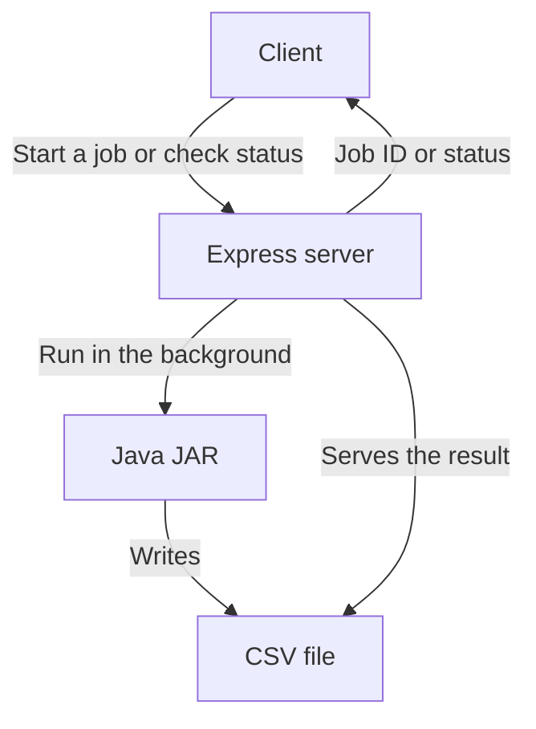

# Salamander Server Plan

- Express lists local videos and shows the first frame as a thumbnail.
- Express runs our Java JAR in the background and returns a job ID right away.
- The JAR writes the CSV. The client checks the job status to get the CSV link.

## How the parts work together

## How I’d test it

- In Postman, start a job for `sample.mp4` and
  check that it returns `202` with a job ID. Use that ID to check the status,
  then open the CSV link when the job is done.

## Job storage

We save each job’s status in a JSON file so we can check it after restarting the server.

## Testing

I tested the server using curl and Postman with `sample.mp4`. Starting a job returned 202 and a job ID. I used that ID to check the status, which returned done with a CSV link. I opened the link and got the results. The CSV had 120 rows for the five-second video. I also ran the automated tests to check error responses and CSV downloads.
