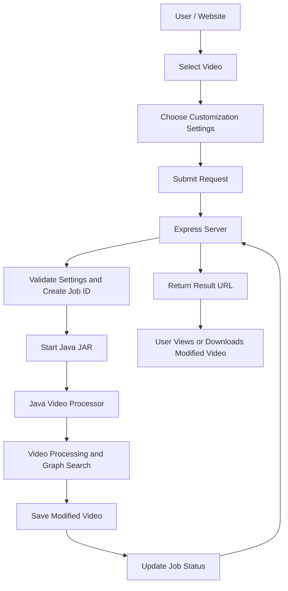
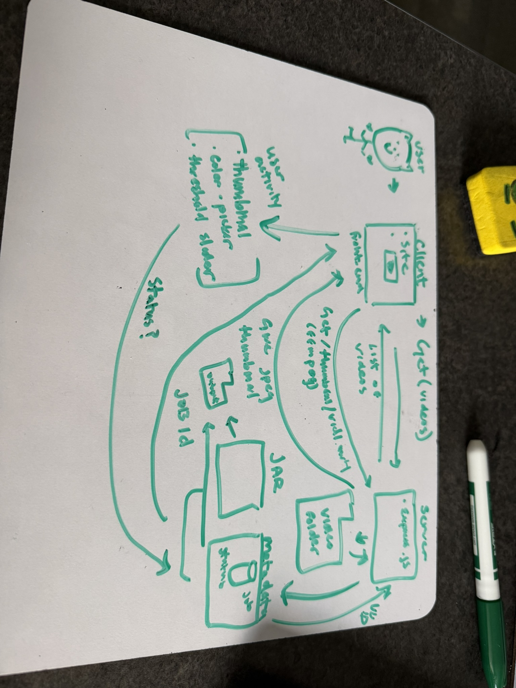
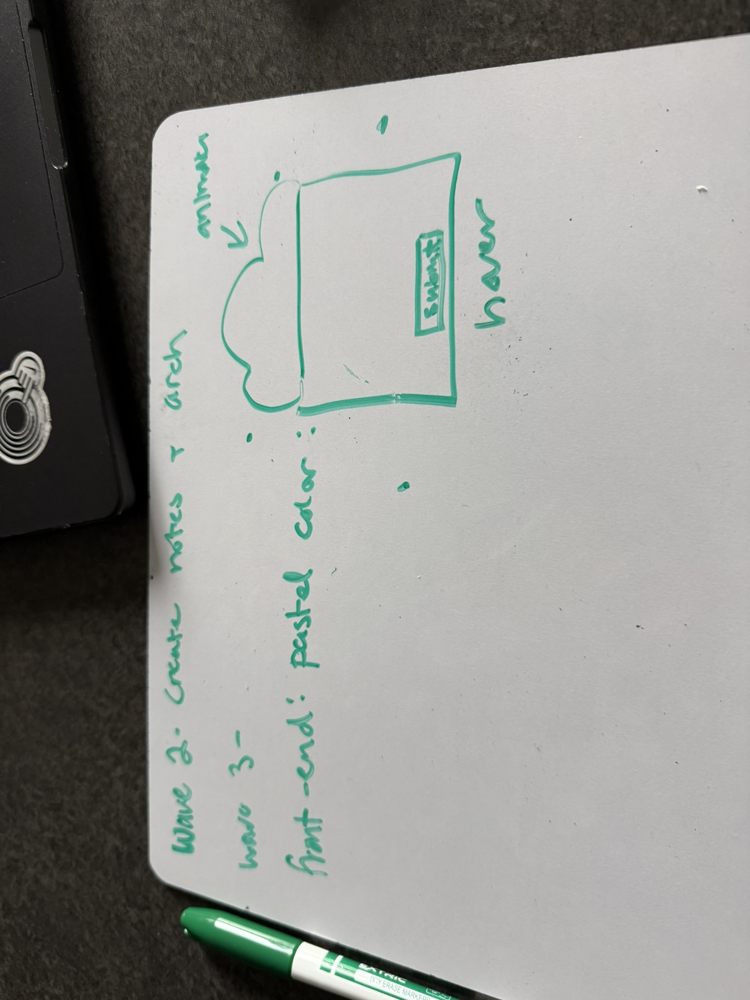

# Salamander API – Updated Server Plan

## 1. Overview
- backend- 
I plan to create a website that allows users to select a video and customize how they want that video processed.
Users will be able to choose a video and change different settings, such as color, opacity, and grouping. After selecting their desired settings, they will submit their request and receive a modified video when processing is complete.

I plan to use Node.js and Express to build the server. Express will handle communication between the website and my existing Java videoProcessor JAR.

The Express server will not contain any graph-search or video-processing algorithms. Instead, it will pass the user's selected video and customization settings to the Java JAR. The Java program will handle all the actual processing.

For now, videos will be stored locally in a directory on my computer. Users will select from the available videos rather than uploading their own.

- frontend- 
Kate and I decided to go with a star theme design with pastel colors such as purple, cyan, and yellow. The background will be a purple sky with animated clouds that are drop down and user-designated, meaning a drop down menu will appear if users click on the cloud icon. There would be an estimate of 6 pages: HomePage, Video Processor, Video Editor, Image Processor, Image Editor, ResultPage. 

## 2. Architecture

AI Used to help create template

Pictures: 

The main responsibilities are:

- **Frontend:** Allows users to select videos and customize processing settings.
- **Express:** Receives requests, validates settings, starts the Java JAR, and tracks job progress.
- **Java JAR:** Performs video processing and all graph-search operations.
- **Filesystem:** Stores original videos, processed videos, thumbnails, and job status information.

