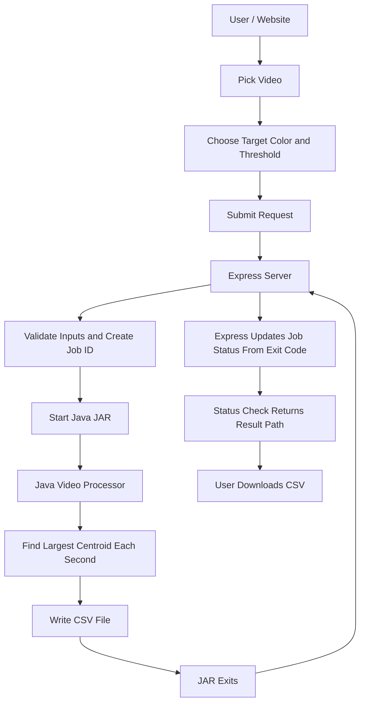
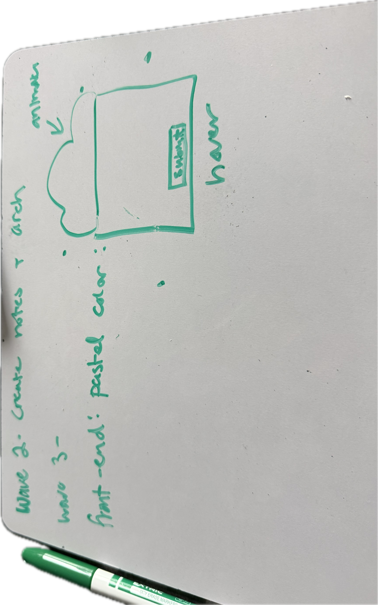

# Salamander API – Server Plan

## 1. Overview

This project is video only (no image processing).

- backend-
I plan to create a server that lets users pick a video that is already on the server, choose a target color and a threshold, and then download a CSV file that tracks the largest group of that color over time.

I plan to use Node.js and Express to build the server. Express will handle communication between the website and my existing Java videoProcessor JAR.

The Express server will not contain any graph-search or video-processing algorithms. Instead, it will pass the selected video, the target color, and the threshold to the Java JAR. The Java program will handle all the actual processing.

Videos are stored locally in a `videos/` folder that Express can access. For now there is no way to upload videos (see "Later" in section 12).

- frontend-
The frontend is not part of this project. It will be built later in the React class. Kate and I are thinking about a star theme with pastel colors (purple, cyan, yellow) and about 4 pages: HomePage, Video Processor, Video Editor, ResultPage. No CSS or styling is being implemented yet.

## 2. Architecture

AI Used to help create template

Pictures:




The main responsibilities are:

- **Frontend (later):** Lets users pick a video and choose the target color and threshold.
- **Express:** Receives requests, validates inputs, starts the Java JAR, tracks job progress, and serves the finished CSV and thumbnails.
- **Java JAR:** Performs all video processing and graph-search operations and writes the CSV.
- **Filesystem:** Stores original videos, CSV results, and job status information.

## 3. Server Code Layout

The server code is split into small files so each one has one job:

- `index.js` starts the server.
- `src/config.js` reads the `.env` values.
- `src/app.js` creates the Express app and connects the routes.
- `src/routes.js` defines the endpoints, validates the inputs, and keeps the handlers short.
- `src/services.js` does the real work: starting the JAR and reading and writing job files.

The Java project lives in its own `processor/` folder. Images for this plan live in `docs/`.

## 4. Customization Options

The user chooses only two settings, sent as query parameters (for example `?targetColor=ff0000&threshold=120`):

- **targetColor:** The color to search for, as a 6-digit hex value (RRGGBB). A browser color picker returns `#RRGGBB`, so if a `#` is present Express removes it before passing it on.
- **threshold:** How close a pixel's color must be to the target color. A whole number (0 or higher).

These are the only two settings the JAR supports.

## 5. Java JAR Contract

The JAR is `processor/target/videoprocessor.jar` and is run like this:

```
java -jar videoprocessor.jar <inputPath> <outputCsv> <targetColor> <threshold>
```

The output CSV has one row per tracked result:

```
seconds,x,y
```

- seconds = number of seconds since the start of the video
- x, y = centroid of the largest group found at that time
- if no group is found, the row uses `-1,-1`

The JAR does not know anything about Express or job status. It only reads the video and writes the CSV. If something goes wrong, it exits with a nonzero exit code and Express marks the job as `error`.

## 6. API Endpoints

There are 4 endpoints. Job status words are exactly `processing`, `done`, and `error`, because the frontend checks for those words.

### GET /api/videos

Returns the list of available video filenames as JSON.

Express will:
- Read the videos directory using Node.js filesystem methods.
- Find available video files.
- Return the filenames as JSON.

### GET /thumbnail/:filename

Returns a thumbnail of the selected video.

Express will:
- Check that the filename is one of the videos in the videos directory.
- Use FFmpeg to extract the first frame.
- Return the thumbnail as a JPEG image.

### POST /process/:filename?targetColor=ff0000&threshold=120

Starts processing a selected video. The color and threshold are query parameters.

Express will:
1. Validate (in `routes.js`) the filename (it must be in the videos directory), the color (exactly 6 hex digits, `#` removed), and the threshold (a whole number, 0 or higher). Bad input gets a 400 response.
2. Generate a unique job ID using UUID.
3. Create a job status record with status `processing`.
4. Start the Java videoProcessor JAR using Node.js child_process (`spawn` with an array of arguments, never one shell string), in detached mode with `stdio: "ignore"`, and call `unref()` so the request never waits for the JAR.
5. Pass the video path, output CSV path (`results/<jobId>.csv`), color, and threshold to Java.
6. Immediately return `202` with `{ "jobId": "..." }`.
7. When the JAR exits, update the job: exit code 0 means `done`, anything else means `error`. Because stdio is ignored, Express cannot see Java's error text, so the failure reason is the exit code (for example "exit code 1").

### GET /process/:jobId/status

Allows the website to check whether the video is still processing.

Express will:
- Find the job using its job ID (404 if it doesn't exist).
- If processing, return `{ "status": "processing" }`.
- If done, return `{ "status": "done", "result": "/results/<jobId>.csv" }`.
- If error, return `{ "status": "error", "error": "<exit code reason>" }`.

### Downloading the result

There is no separate download route. The `results/` folder is hosted with `express.static` at `/results`, so the `result` path from the status response can be requested directly.

## 7. Java JAR Communication

The Express server uses Node.js child_process to start the Java videoProcessor JAR.

The server passes the video path, the output CSV path, the target color, and the threshold as command-line arguments.

The process runs detached with ignored stdio, so Express does not wait for it. Express still listens for the exit event to learn the exit code. The exit code decides the job status. The JAR itself never writes job status.

## 8. File Storage

We plan to store files locally using the filesystem.

```text
centroid-finder/
├── .github/
├── .gitignore
├── LICENSE
├── README.md
├── plan.md
├── serverPlan.md
├── .env
├── docs/
│   └── (images)
│
├── processor/              (Java project, run "mvn package" here)
│
├── server/
│   ├── index.js
│   ├── src/
│   │   ├── config.js
│   │   ├── app.js
│   │   ├── routes.js
│   │   └── services.js
│   └── package.json
│
├── videos/
│   └── video.mp4
│
├── results/
│   ├── job-id-1.csv
│   └── job-id-2.csv
│
└── jobs/
    ├── job-id-1.json
    └── job-id-2.json
```

The jobs directory will store information about each processing request, including its ID, selected video, color, threshold, status, and result location.

`.env` is committed on purpose: it only holds folder paths, no secrets. The built JAR, `videos/`, `results/`, `jobs/`, and any video files are not committed. Add them to `.gitignore`.

## 9. Environment Variables

Using dotenv to store important directory paths and configuration values in the `.env` file in the main folder. `config.js` reads the paths relative to the main folder.


This will make it easier to change file locations without modifying the Express code.

## 10. Setup After Pulling

1. Run `npm i` inside `server/`.
2. Check the paths in `.env` (it is already in the repo).
3. Make the `videos/` folder in the main folder and put the salamander video in it (do not commit it).
4. Build the JAR: `cd processor && mvn package`.
5. Start the server with `npm run dev` inside `server/`.

## 11. Known Limits

- If the server stops while a job is running, that job stays `processing` forever.
- Processing the same video twice at the same time is fine only because each job writes its own CSV named `<jobId>.csv`.
- Job files survive a server restart, but running processes and their exit callbacks do not.
- The failure reason is only an exit code, since Java's output is ignored.

## 12. Implementation Order

1. Set up the Express server using the file layout above.
2. Install Express, dotenv, and UUID.
3. Configure the environment variables.
4. Implement the list of available videos.
5. Implement the thumbnail endpoint with FFmpeg.
6. Create the process request with query parameters for target color and threshold.
7. Implement job ID generation and job status storage.
8. Implement communication between Express and the Java JAR.
9. Update job status from the JAR's exit code.
10. Implement job status checking and serve `results/` with `express.static`.
11. Test the entire process from picking a video to downloading the CSV (unit tests and Postman).

Later:
- Uploading videos (`POST /upload` with multer). Not part of the current API.
- CSS and styling, which belong to the React frontend.

## 13. Things to Research

- Express routes and HTTP requests.
- express.static for serving the results folder.
- dotenv and environment variables.
- Node.js child_process: running a JAR detached, `stdio: "ignore"`, `unref()`, and exit codes.
- UUID for generating job IDs.
- Validating user input (filenames, hex colors, numbers).
- FFmpeg for extracting the first frame of a video.
- Later: file uploads with multer.